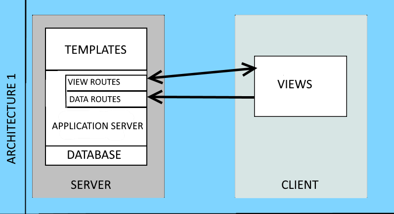
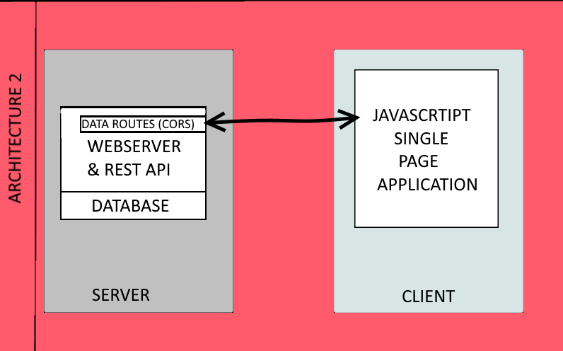

# Flask Sample Application
Flask app for educational purposes. Two implementations; Non-JS flask app and JS SPA with flask backend.


## Server Side Rendered - Full stack Flask Application (App1)


## Client Side Renedered - JS SPA with Flask REST API (APP2)



## Demo

[DemoLink](https://snick-flask-sample.herokuapp.com/)


## Getting Started

### Prerequisites
- Python 3.12+
- pip

### Install dependencies
```bash
pip3 install -r requirements.txt
```

### Environment configuration
This project uses Flask CLI with python-dotenv to load a single `.flaskenv` file for local development.
- `.flaskenv` contains defaults (already included):
	- `FLASK_APP=main.py`
	- `FLASK_DEBUG=1`
	- `FLASK_RUN_HOST=0.0.0.0`
	- `FLASK_RUN_PORT=5000`
If you need to change the database path, you can set `SQLALCHEMY_DATABASE_URI` directly in `.flaskenv` as well.

### Initialize the database with sample data
This will remove the current SQLite file and recreate it with seeded records.
```bash
flask init
```

### Run the development server
Use Flask CLI (loads `.flaskenv` automatically):
```bash
flask run
```
Optional overrides per-run:
```bash
FLASK_RUN_HOST=127.0.0.1 FLASK_RUN_PORT=5001 flask run
```

## Production

### Run with gunicorn locally
```bash
gunicorn main:app
```

### Notes
- The SQLite database file is `lab6.db` in the project root.
- The Flask app auto-creates tables on startup; use `flask init` anytime you want a clean database with sample data.
- Two app variants are available:
	- Server-side rendered routes (App1): `/app1`, `/` index page
	- Client-side (App2) using REST API: `/app2` with API under `/api/*`


